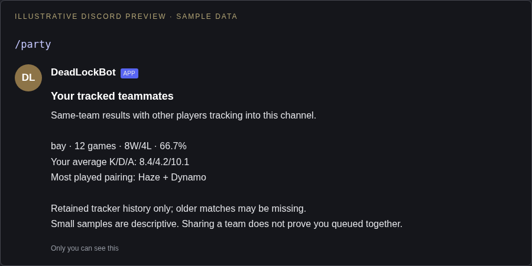

# Tracked teammate stats

Use `/party` in the channel you registered with `/signup`. The response is private unless you set `public:True`, which posts it in that channel. It considers only other registered players whose tracking channel matches this channel, and uses cached summaries without Steam lookups.

Illustrative preview:

```text
Your tracked teammates
Same-team results with other players tracking into this channel.

bay · 12 games · 8W/4L · 66.7%
Your average K/D/A: 8.4/4.2/10.1
Most played pairing: Haze + Dynamo
```

Results are sorted by shared game count, with up to six teammates. Opposing-team encounters, unknown outcomes and inconsistent results are excluded. The most-played hero pairing shows your hero first. These are observed teammates: metadata does not establish a premade party or friendship, and the bot does not claim that the teammate caused a higher win rate. Only retained history is available, so this is not a lifetime report.

To try it after deployment, two players sign up in the same channel, play together, wait for tracking to collect their match, then run `/party`. No schema migration or configuration is required.

## Visual preview

Illustrative Discord layout using sample values; Discord fonts and spacing vary by client.


