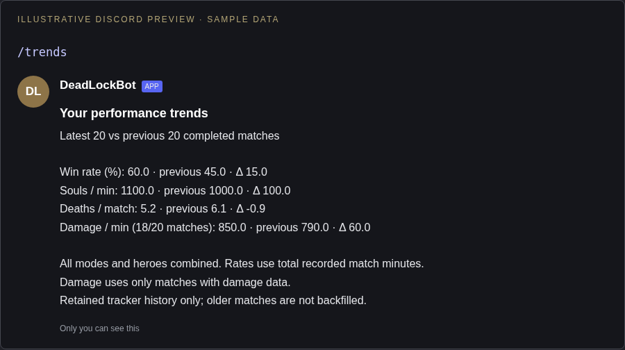

# Personal performance trends

Run `/trends` after `/signup`. Only you see the response unless you set `public:True`, which posts it in the channel. The command reads retained tracker data; it does not spend Steam metadata queries.

Illustrative Discord response (sample values):

```text
Your performance trends
Latest 20 vs previous 20 completed matches

Win rate (%): 60.0 · previous 45.0 · Δ 15.0
Souls / min: 1100.0 · previous 1000.0 · Δ 100.0
Deaths / match: 5.2 · previous 6.1 · Δ -0.9
Damage / min (18/20 matches): 850.0 · previous 790.0 · Δ 60.0
```

The actual response explains coverage, mixed modes/heroes, and missing damage. Fewer than 40 matches produces a partial-history notice. Damage coverage can differ between windows; values are descriptive, not a skill rating. All rate totals are weighted by match duration. Cached history retention rises from 25 to 40 rows per player; already deleted history cannot be restored. There is no database schema change.

After deployment, restart the bot to register `/trends`, sign up, allow history collection, then run the command. Existing notifications and reports continue to work.

## Visual preview

Illustrative Discord layout using sample values; Discord fonts and spacing vary by client.


