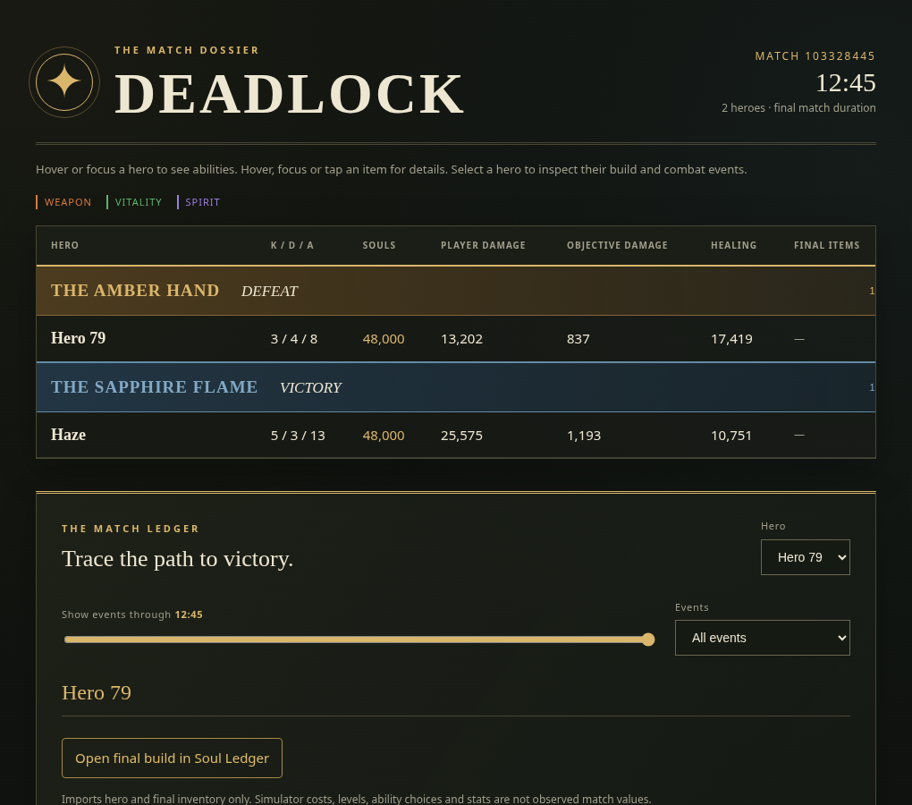

# Open a match build in Soul Ledger

1. Run `/match` or use **Open full match** on a notification.
2. Choose **Explore match**, select a hero, then **Build**.
3. Click **Open final build in Soul Ledger**. The same link appears in each hero's build section in the downloaded HTML report.
4. Soul Ledger previews the hero and final inventory; choose **Import final inventory** to start editing.

Illustrative Discord Build view:

```text
Match 116526948 · Haze · Build
• Final recorded item A
• Final recorded item B

[ Open final build in Soul Ledger ↗ ]
```

The button is a normal external link to `https://abdullah2808.github.io/Soul-Ledger/`. The URL fragment carries a versioned JSON payload: `v:1`, numeric `hero`, numeric `items` (up to 12), and a string `match` ID. Account IDs and player names are excluded. URL fragments are handled by the browser and are not included in HTTP requests. Unknown catalog entries retain their numeric IDs so the importer can report them rather than silently replacing items. Sold items and known ability events are excluded.

This exports **final inventory only**. It does not recreate purchase order, match net worth, level, ability tiers, imbue targets, or the exact historical patch. Current simulator costs and derived stats are not observed match stats. Missing inventory/catalog data disables the link with an explanation in the HTML report.

Dependency: the companion Soul Ledger import PR must be merged and deployed to GitHub Pages before users can import these links. The bot PR does not publish the simulator or deploy the bot. Existing PNG/HTML reports remain usable offline; opening the simulator requires internet access.

## Visual preview

Actual HTML report rendered with the repository’s sample fixture.


