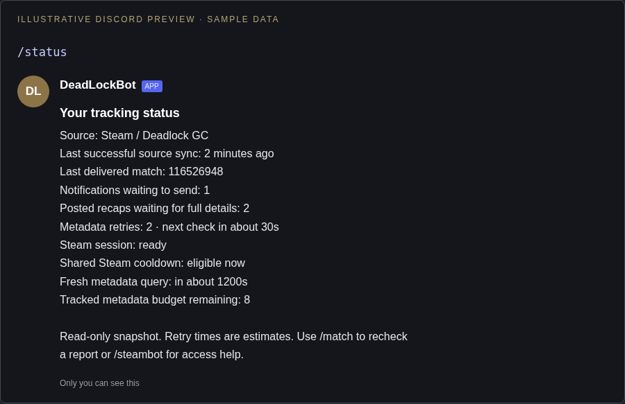

# Tracking status

Run `/status` after `/signup`. Only you see the response; it shows only your notification and retry counts. Reading status never sends Steam or public-API requests.

Illustrative preview:

```text
Your tracking status
Source: Steam / Deadlock GC
Last successful source sync: 2 minutes ago
Last delivered match: 116526948
Notifications waiting to send: 1
Posted recaps waiting for full details: 2
Metadata retries: 2 · next check in about 30s
Steam session: ready
Shared Steam cooldown: eligible now
Fresh metadata query: in about 1200s
Tracked metadata budget remaining: 8
```

Discord renders the sync timestamp relative to the viewer. The shared cooldown and fresh-metadata budget are distinct, and a ready session does not guarantee access to a match. A busy metadata lock is reported as busy rather than blocking behind network work. Public-feed mode explicitly warns of partial coverage. Retry estimates describe eligibility, not a guaranteed report delivery time. The separate deadlock-api fallback quota is not exposed by this command.

Source sync and unsent counts are observations since process startup; persisted posted-notification enrichment and last-delivered match survive restarts. Queue snapshots can change immediately after reading. The command is available after restarting the deployed bot; no database schema change or configuration is needed.

## Visual preview

Illustrative Discord layout using sample values; Discord fonts and spacing vary by client.


