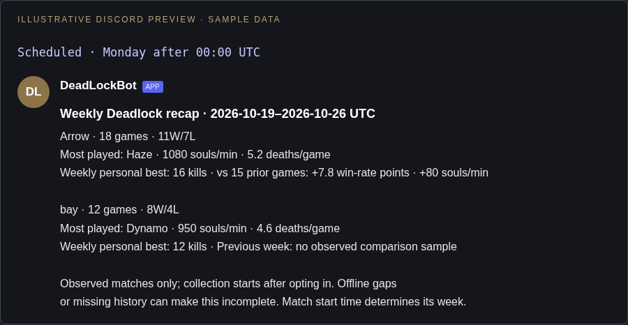

# Weekly Discord digest

Run `/weekly action:enable` in your registered tracking channel to opt in. `/weekly action:disable` removes your subscription; `/weekly action:preview` privately previews your last completed week, or shares it in the channel with `public:True`. Enabling and disabling always stay private. Instant recaps continue as before.

Starting with the first Monday after opting in, after 00:00 UTC, the scheduler sends one message per channel for opted-in players. The first cycle after a restart catches up only the most recently completed week; older weeks are not replayed. Match **start time** assigns the week, using [Monday 00:00, next Monday 00:00). No configurable timezone is introduced in this version.

Illustrative channel preview:

```text
Weekly Deadlock recap · 2026-10-19–2026-10-26 UTC

Arrow · 18 games · 11W/7L
Most played: Haze · 1080 souls/min · 5.2 deaths/game
Weekly personal best: 16 kills · vs 15 prior games: +7.8 win-rate points · +80 souls/min

bay · 12 games · 8W/4L
Most played: Dynamo · 950 souls/min · 4.6 deaths/game
Weekly personal best: 12 kills · Previous week: no observed comparison sample

Observed matches only; collection starts after opting in.
```

A separate archive retains 21 days of observed summaries for opted-in accounts. GC history refreshes fill it without additional lookups; active-feed discoveries also contribute. It is not a promise of complete history, particularly during downtime or in active-feed mode. Existing short report-cache retention cannot evict these summaries. The first digest may be partial. At most five players appear in the shared message; others can use their private preview.

Three additive tables are created on startup: settings, observed matches, and delivered weeks. Delivery is marked only after Discord accepts the post, and retries preserve failures. Normal restarts do not resend recorded deliveries. A crash between Discord acceptance and database persistence can duplicate a recap (the existing match notifications have the same limitation). A channel whose recap is already delivered does not get an extra recap when someone opts in later that week. Subscriptions are honored only while the account and tracking channel still match the registration.

After deployment, enable a subscription, let matches be observed, and use preview after a completed UTC week. Scheduled live posting requires the normal Send Messages permission and a running bot. No production messages are sent by the PR or its tests.

## Visual preview

Illustrative Discord layout using sample values; Discord fonts and spacing vary by client.



The weekly personal best is the highest kill count among that week’s observed games, not a lifetime record. Comparisons use the prior UTC week’s observed sample and display its size; they do not claim complete coverage or statistical significance.
